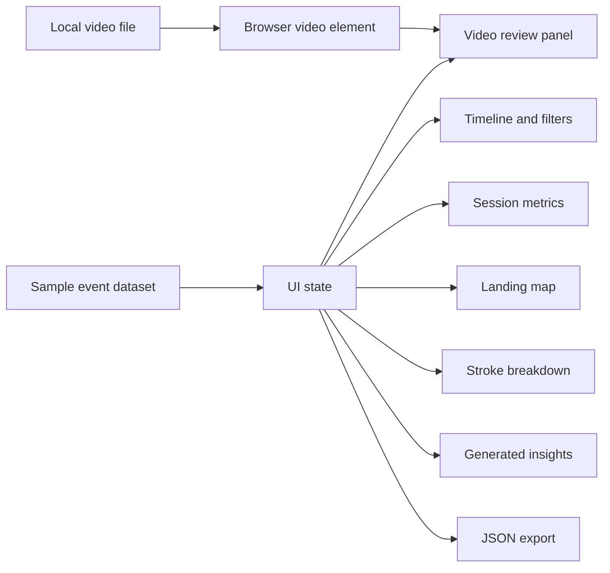
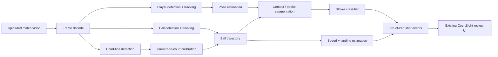

# CourtSight — prototype architecture

## Current status

CourtSight is currently a browser-based product prototype, not a completed computer-vision inference system.

A user can load a local video and interact with the analysis workflow, but the displayed shot classifications, speeds, confidence values, rally numbers, and landing coordinates come from the in-page `sampleEvents` dataset. The staged "calibration", "tracking", and "classification" messages are UI simulation used to demonstrate the intended product flow.

That boundary is deliberate: the prototype validates the review experience before committing to a heavier video-processing stack.

## Current architecture



Everything runs locally in the browser. There is no backend, database, account system, uploaded video storage, or external model API.

## Main UI components

### Video review

The browser loads a selected video using `URL.createObjectURL`. The current prototype does not upload the file to a server.

The video panel also displays simulated overlays for:

- stroke label;
- timestamp and rally;
- confidence;
- estimated speed;
- landing description;
- decorative ball and pose-tracking indicators.

### Event timeline

Each event records:

- timestamp;
- rally number;
- stroke type;
- speed;
- confidence;
- in/out result;
- landing-depth description;
- normalized court coordinates.

Filters group related stroke types into higher-level families such as forehand and backhand.

### Session metrics

The prototype derives summary metrics from the event array:

- total shots;
- maximum recorded speed;
- in percentage;
- average rally length;
- attack rate;
- average model confidence.

The current attack-rate heuristic counts a shot as attacking when its speed is at least 75 mph or its landing description contains `deep`.

### Landing map

Each event's normalized `x` and `y` values are rendered on a CSS tennis court.

The UI also calculates simple zone counts for:

- ad-side deep landings;
- deuce-side deep landings;
- short balls.

These are visualization heuristics, not coordinates derived from camera geometry.

### Insights

The browser creates lightweight session observations from the current events, for example attacking forehand count, average backhand speed, and the number of balls that finished out.

These are deterministic summaries rather than LLM-generated coaching advice.

### Export

The Export JSON action serializes the current session mode and event list into a local file. No data is sent to a remote service.

## Intended production CV pipeline

A production version could replace the sample analyzer with the following pipeline:



## Suggested production data contract

Instead of hard-coded `sampleEvents`, the front end could consume structured events like:

```json
{
  "timestamp_ms": 14200,
  "rally_id": 1,
  "stroke": "inside_out_forehand",
  "stroke_confidence": 0.92,
  "speed_mph": 81.0,
  "landing": {
    "in": true,
    "court_x": 0.57,
    "court_y": 0.29
  },
  "tracking": {
    "ball_confidence": 0.88,
    "player_confidence": 0.95
  }
}
```

Keeping model output in a stable event schema would allow the UI to evolve independently from the CV models.

## Model-development stages

A practical implementation path is:

1. **Court calibration** — detect court lines and estimate the homography between image space and court space.
2. **Ball tracking** — detect the tennis ball per frame, bridge short occlusions, and smooth the trajectory.
3. **Player and pose tracking** — identify the relevant player and track body landmarks over time.
4. **Contact detection** — infer likely racket-ball contact frames from ball trajectory and player motion.
5. **Stroke classification** — classify segments into serve, return, forehand, backhand, slice, volley, and other useful categories.
6. **Landing estimation** — intersect the tracked trajectory with the calibrated court plane.
7. **Speed estimation** — combine frame timing with calibrated distance while handling perspective and tracking noise.
8. **Event aggregation** — group contacts into rallies and compute session statistics.

## Evaluation plan

Each CV component should be evaluated separately before claiming end-to-end performance.

Useful metrics include:

- court keypoint or line reprojection error;
- ball detection precision/recall;
- tracking continuity and localization error;
- contact-frame timing error;
- stroke-classification macro F1 and confusion matrix;
- landing-position error in metres;
- in/out accuracy;
- speed mean absolute error against a trusted reference.

End-to-end evaluation should use held-out videos from different courts, cameras, lighting conditions, player levels, and clothing/background combinations.

## Risks and limitations

A production system would need to handle:

- small and blurred tennis balls;
- motion blur and occlusion;
- camera shake;
- different camera heights and zoom levels;
- partial court visibility;
- doubles players;
- indoor and outdoor lighting;
- frame-rate metadata errors;
- uncertain contact timing;
- distribution shift between training footage and user uploads.

Confidence values should represent calibrated model uncertainty rather than decorative percentages.

## Privacy and deployment

Local-first processing is attractive for sports video because footage can contain identifiable people.

Possible deployment choices include:

- fully local desktop processing;
- client-side lightweight models for some stages;
- encrypted cloud upload with short retention;
- background GPU processing with job-status polling.

A production service should make retention, deletion, sharing, and model-training use explicit to users.

## Interview walkthrough

A concise explanation is:

> CourtSight is currently a front-end prototype that validates how a player would review computer-vision outputs. I kept the model boundary honest: the UI uses sample events today, but the event schema and landing-map workflow are designed so a real court-calibration, ball-tracking, pose, and stroke-classification pipeline can replace that data source later.

The strongest technical discussion is the separation between the future perception pipeline and the review interface. That separation makes it possible to test model components independently and keep a stable contract for the front end.
